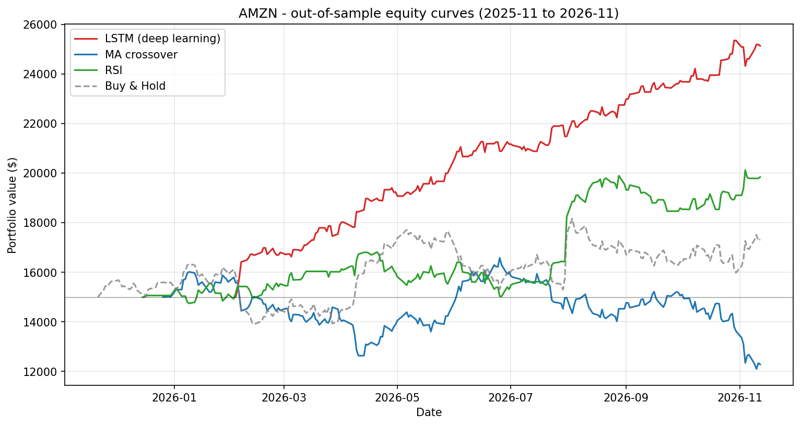
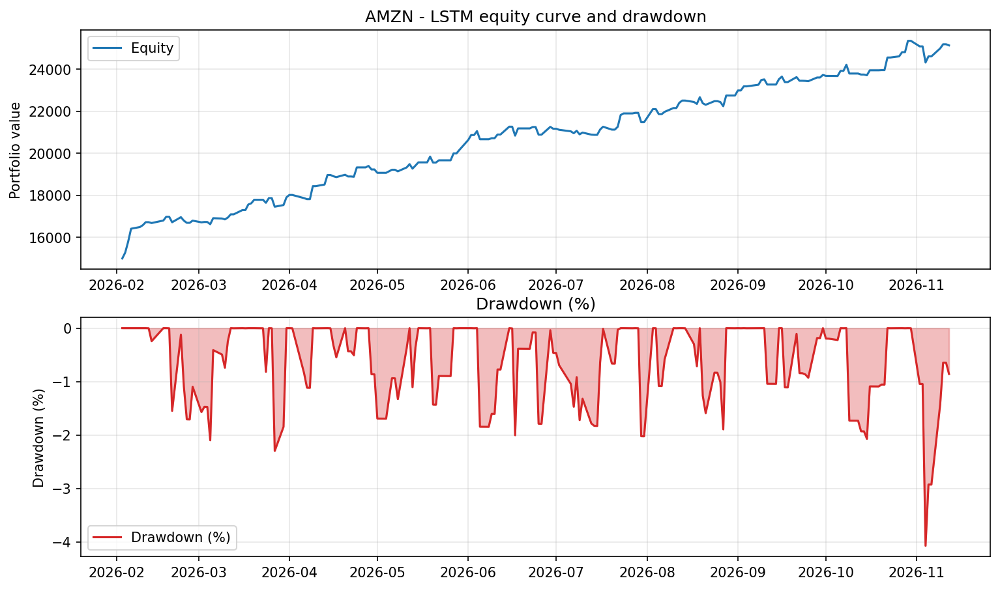
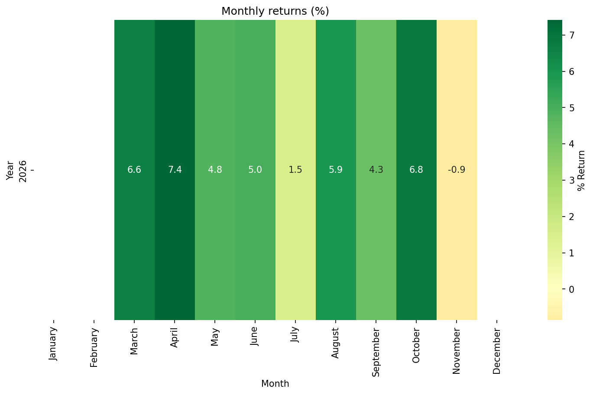

# AI-Based Stock Trading Strategy

[](https://github.com/vyakamm/AI-Based-Stock-Trading/actions/workflows/ci.yml)
[](https://www.python.org/)
[](LICENSE)
[](https://github.com/astral-sh/ruff)
[](#development)

A research framework that trains deep learning and machine learning models to
predict the next-day price change of a stock, and evaluates the resulting
trading strategies with a risk-managed, event-driven backtester.

The project ships with pre-trained models for **AMZN** (2022-2026 daily data),
a reproducible benchmark of **7 strategies**, and a CLI to backtest, train and
optimize your own.



> **Disclaimer** — This project is for **educational and research purposes
> only**. Nothing in this repository is financial advice. Backtest results are
> computed on historical data with simplifying assumptions (fixed position
> size, idealized fills) and **do not guarantee future returns**. Trade at your
> own risk.

---

## Features

- **7 pluggable strategies**, all sharing the same `generate_signal()` interface:
  deep learning (stacked **LSTM**), classical ML (**Random Forest**, **XGBoost**,
  **SVM**, **KNN**) and technical indicators (**MA crossover**, **RSI**).
- **Event-driven backtester** with long/short positions, stop-loss risk
  management, proportional + minimum transaction costs, and mark-to-market
  equity tracking.
- **20+ performance metrics**: Sharpe, Sortino, Calmar, recovery factor, max
  drawdown, win rate, profit factor, payoff ratio, VaR (daily/monthly), risk
  of ruin, monthly heatmap, trade streaks...
- **Optuna hyperparameter optimization** with automatic persistence of the
  best parameters (XML) and models (`.h5` / `.pkl`).
- **One-command CLI** (`dl-trading backtest / train / optimize`) and a clean
  Python API.
- **Reproducible**: pinned dependencies, deterministic seeds, 67 unit tests,
  GitHub Actions CI.

## Quickstart

```bash
git clone https://github.com/vyakamm/AI-Based-Stock-Trading.git
cd AI-Based-Stock-Trading

python -m venv .venv && source .venv/bin/activate     # Windows: .venv\Scripts\activate
pip install -r requirements.txt
pip install -e .

# Backtest the pre-trained LSTM on the AMZN test window (2025-11 -> 2026-11)
dl-trading backtest --symbol AMZN --strategy lstm
```

That single command loads the shipped model, replays the strategy on the
out-of-sample period, prints a full report and saves charts + metrics under
`outputs/`.

### Programmatic API

```python
from dl_trading.pipeline import build_strategy, load_or_default_hyperparams
from dl_trading.backtesting.backtester import Backtester, BacktesterParameters
from dl_trading.data.loader import download_and_split_data

train_data, test_data = download_and_split_data("AMZN", local_path="data/AMZN.csv")
hyperparams = load_or_default_hyperparams("AMZN", "lstm", artifacts_dir="artifacts")

strategy = build_strategy("lstm", "AMZN", hyperparams, artifacts_dir="artifacts")
backtester = Backtester(BacktesterParameters(stop_loss=hyperparams["stop_loss"],
                                             past_history=hyperparams["past_history"]))
results = backtester.run_backtest(test_data, strategy)
print(results.metrics["total_return_pct"], results.metrics["sharpe_ratio"])
```

A complete runnable example lives in [`examples/quickstart.py`](examples/quickstart.py).

## CLI reference

| Command | Purpose | Key options |
|---|---|---|
| `dl-trading backtest` | Replay a strategy and print a report | `--strategy`, `--symbol`, `--use-yfinance`, `--data`, `--output-json`, `--no-plots` |
| `dl-trading train` | Fit a model and persist it | `--strategy`, `--past-history`, `--epochs`, `--n-estimators`, ... |
| `dl-trading optimize` | Optuna hyperparameter search | `--strategy`, `--trials`, `--jobs`, `--seed` |

```bash
# Run on any Yahoo Finance ticker instead of the bundled AMZN data
dl-trading backtest --symbol MSFT --strategy ma --use-yfinance --start-date 2020-01-01

# Train your own LSTM (30 epochs, 60-day window)
dl-trading train --symbol AMZN --strategy lstm --past-history 60 --epochs 30

# Search the best moving-average parameters (50 Optuna trials)
dl-trading optimize --symbol AMZN --strategy ma --trials 50
```

## Out-of-sample results (AMZN)

All strategies replay the **same test window** (Nov 2025 - Nov 2026, 245
trading days, strictly out of sample), with identical settings: $15,000
initial capital, 50 units per position, stop loss and parameters taken from
each strategy's saved artifacts. Regenerate everything with
`python scripts/generate_report.py`.

| Strategy | Total return | Ann. return | Volatility | Sharpe | Max DD | Win rate | Trades |
|---|---:|---:|---:|---:|---:|---:|---:|
| **LSTM** | **+67.6 %** | +95.0 % | 15.9 % | **4.26** | **-4.1 %** | 72.4 % | 117 |
| Random Forest | +39.6 % | +45.5 % | 19.7 % | 2.00 | -8.1 % | 57.6 % | 133 |
| RSI | +32.3 % | +36.0 % | 21.8 % | 1.52 | -10.6 % | 58.8 % | 69 |
| XGBoost | +17.9 % | +20.3 % | 25.0 % | 0.86 | -23.6 % | 50.6 % | 158 |
| Buy & Hold | +15.5 % | +16.0 % | 25.4 % | 0.71 | — | — | 1 |
| KNN | +11.3 % | +12.8 % | 26.1 % | 0.59 | -16.8 % | 44.7 % | 153 |
| SVM | -19.5 % | -21.6 % | 27.4 % | -0.75 | -23.2 % | 47.2 % | 144 |
| MA crossover | -18.1 % | -20.3 % | 25.5 % | -0.77 | -27.0 % | 38.9 % | 36 |

### What we learn from these numbers

- **Rankings are regime-dependent.** On the previous benchmark window
  (Nov 2024 - Oct 2025) the same framework ranked KNN first (+16.4 %) and the
  LSTM last (-3.0 %) — the side-by-side comparison is in
  [`docs/methodology.md` §7](docs/methodology.md). Same code, same backtest
  engine, different period, different winner: a single backtest window cannot
  establish a persistent edge, which is why walk-forward validation sits at
  the top of the roadmap.
- **Read spectacular numbers skeptically.** A Sharpe ratio of 4.26 with a
  72 % win rate over ~10 months is an outlier, not a reproducible edge. The
  shipped LSTM checkpoint was trained before the refactoring of this
  repository (see methodology §7), and risk-adjusted results of this
  magnitude rarely survive out-of-sample revalidation.
- **Same indicator family, opposite outcomes.** RSI rode the 2026 uptrend
  (+32.3 %) while the MA crossover whipsawed to -18.1 % with a -27.0 % max
  drawdown — "rule-based" does not automatically mean "robust".
- **Costs are modeled, execution is idealized.** At the default cost settings
  each trade pays the $0.35 minimum, so the LSTM paid ~$41 over 117 trades
  and the MA crossover ~$13 over 36. Slippage, borrowing fees and market
  impact are deliberately out of scope (methodology §6).
- Full metric dictionaries are in [`outputs/results.json`](outputs/results.json)
  and [`outputs/metrics_summary.csv`](outputs/metrics_summary.csv).

### LSTM analytics

<p>
  
  
</p>

## How it works

```
 Market data (CSV / Yahoo Finance)
        │
        ▼
 ┌─────────────────────┐     features per day t-Δ…t-1:
 │  data/preprocessing │       • Open − Adj.Close  (overnight gap)
 └─────────────────────┘       • High − Low          (intraday range)
        │                      target: Adj.Close[t] − Adj.Close[t-1]
        ▼
 ┌─────────────────────┐    LSTM  (sequences, Keras)
 │  models             │    RandomForest / XGBoost / SVM / KNN (flattened, sklearn)
 └─────────────────────┘
        │  prediction > 0 → BUY, else SELL
        ▼
 ┌─────────────────────┐    long / short / flat, stop loss,
 │  backtesting engine │    transaction costs, mark-to-market
 └─────────────────────┘
        │
        ▼
 ┌─────────────────────┐    Sharpe, Sortino, Calmar, VaR, drawdown,
 │  performance        │    win rate, profit factor, monthly heatmap…
 └─────────────────────┘
```

The feature/target design is strictly causal: the model sees only data
available *before* the day whose price change it predicts. Details and the
full metric glossary are documented in
[`docs/methodology.md`](docs/methodology.md).

## Project structure

```
├── .github/workflows/ci.yml    # lint + tests on Python 3.10-3.12
├── artifacts/                  # pre-trained models + best hyperparameters (AMZN)
│   ├── models/                 #   *.h5 (LSTM), *.pkl / *.joblib (ML models)
│   └── hyperparams/            #   best_hyperparams_<SYMBOL>_<STRATEGY>.xml
├── data/AMZN.csv               # bundled example dataset (2022-01 -> 2026-11)
├── docs/
│   ├── methodology.md          # features, target, backtest engine, metrics glossary
│   └── assets/                 # charts embedded in this README
├── examples/quickstart.py      # runnable Python API example
├── outputs/                    # regenerated benchmark: results.json, metrics_summary.csv, charts
├── scripts/
│   ├── generate_report.py      # regenerates the benchmark table + charts
│   └── import_data.R           # optional R/quantmod data importer
├── src/dl_trading/
│   ├── backtesting/            # backtester, performance analyzer, benchmarks
│   ├── data/                   # loaders, validation, preprocessing
│   ├── models/                 # LSTM + sklearn wrappers
│   ├── optimization/           # Optuna optimizer
│   ├── strategies/             # strategy classes + registry
│   ├── cli.py                  # dl-trading entry point
│   └── pipeline.py             # train / load / build orchestration
└── tests/                      # 67 unit tests (pytest)
```

## Development

```bash
pip install -e ".[dev,tensorflow-cpu,xgboost]"
ruff check src tests          # lint
ruff format --check src tests # formatting
pytest                        # 67 tests, ~11 s
python scripts/generate_report.py   # regenerate the README numbers
```

Continuous integration runs ruff and the full test suite on Python 3.10, 3.11
and 3.12. Contributions are welcome - see
[CONTRIBUTING.md](CONTRIBUTING.md).

## Roadmap

- [ ] Walk-forward validation instead of a single train/test split
- [ ] Probability-calibrated position sizing (fractional Kelly)
- [ ] Additional features (volume, returns lags, technical indicators)
- [ ] Live-paper-trading connector (broker API)
- [ ] Hyperparameter optimization reports (Optuna dashboards)

## License

Released under the [MIT License](LICENSE) - free to use, modify and
distribute with attribution.
